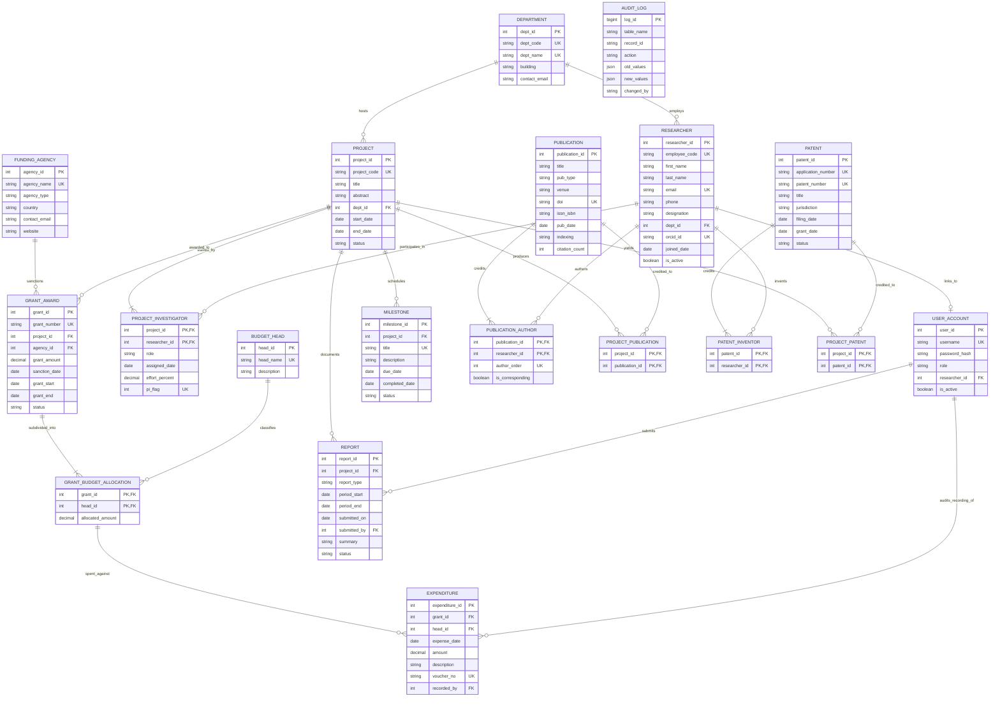

# Entity-Relationship (ER) Model

This document outlines the conceptual data model for the Research Project, Publication & Grant Management System (RPGMS). It visualizes all 19 entities, their key attributes, primary and foreign key constraints, and relational cardinalities.

---

## 1. Complete Entity-Relationship Diagram

---

## 2. Plain-Language Tour of the Model

The RPGMS data model is architected around the operational reality of university research administration:

1. **Academic Organization:**
   - A `DEPARTMENT` anchors academic faculties and research projects.
   - Each `RESEARCHER` belongs to exactly one department (`1 : N`), while a department hosts multiple faculty members and students.
   - Faculty members can be assigned a `USER_ACCOUNT` (`0..1 : 0..1`), linking web login identities to academic researcher profiles.

2. **Project Governance & Staffing:**
   - A `PROJECT` represents an approved research initiative, hosted in a department (`1 : N`).
   - Researchers join projects through `PROJECT_INVESTIGATOR` (`M : N`).
   - A key constraint in this relationship is the **Principal Investigator (PI) Invariant**: every project must have exactly one PI. This is modeled using a stored generated column `pi_flag` (value `1` for PI, `NULL` otherwise) and a unique key on `(project_id, pi_flag)`. MySQL unique indexes permit multiple `NULL` values but strictly one `1`, enforcing that a project never has more than one PI.

3. **Financial Lifecycle (Grants, Allocations & Expenditures):**
   - External sponsors (`FUNDING_AGENCY`) sanction `GRANT_AWARD` records for specific projects (`1 : N`).
   - Rather than spending freely against a lump sum, a grant is subdivided across standardized expense categories (`BUDGET_HEAD`) in `GRANT_BUDGET_ALLOCATION` (`M : N`).
   - When money is spent, an `EXPENDITURE` row is recorded. Notice the **composite foreign key** `(grant_id, head_id)` pointing directly to `GRANT_BUDGET_ALLOCATION`. This enforces at the database constraint level that money can only be disbursed against a budget head that was formally allocated to that specific grant.

4. **Technical Progress & Reporting:**
   - Deliverables are scheduled in `MILESTONE` with explicit due dates bounded by the parent project's lifetime.
   - Periodical compliance and progress are recorded in `REPORT`, tracking draft, submission, and research office review stages.

5. **Scholarly & Intellectual Output:**
   - Research papers (`PUBLICATION`) credit multiple researchers in an ordered sequence through `PUBLICATION_AUTHOR` (`M : N`), and are linked to the sponsoring grants via `PROJECT_PUBLICATION` (`M : N`).
   - Inventions (`PATENT`) track legal statuses (Filed, Published, Granted) and are attributed to inventors via `PATENT_INVENTOR` and projects via `PROJECT_PATENT`.

6. **System Accountability:**
   - Every state change across these 18 business entities triggers an automated entry in `AUDIT_LOG`, capturing the mutation type, affected table and record identifier, previous and new JSON row representations, timestamp, and authenticated application username (`@rpgms_actor`).
