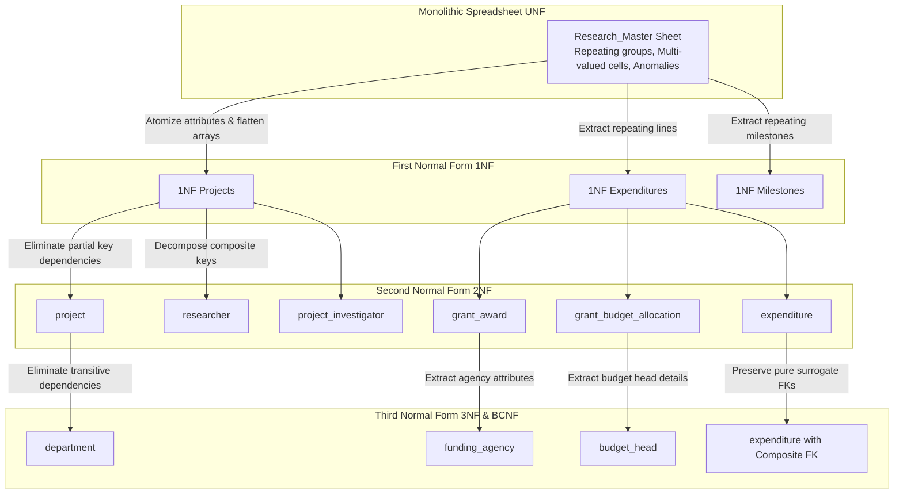

# Database Normalization Analysis (UNF to 3NF/BCNF)

This document provides a rigorous, step-by-step walkthrough of normalizing the Research Project, Publication & Grant Management System (RPGMS) from a monolithic spreadsheet (UNF) to Third Normal Form (3NF) and Boyce-Codd Normal Form (BCNF).

---

## 1. Unnormalized Form (UNF): The Legacy Spreadsheet

Before computerization, university research offices traditionally maintained a single, flat spreadsheet called `Research_Master`. A sample of 5 representative rows illustrates the widespread presence of repeating groups, multi-valued cells, and composite structures:

### Sample `Research_Master` Sheet (UNF)

| Project Code | Project Title | Department & Bldg | PI Name & Email | Co-Investigators (Names & Efforts) | Funding Agency & Type | Grant No & Amount | Budget Heads & Allocations | Expenditures (Voucher, Date, Head, Amount) | Milestones (Title, Due, Status) | Publications (Title, DOI, Venue) |
|---|---|---|---|---|---|---|---|---|---|---|
| `RP-2024-001` | Soil Moisture Sensing | Civil Engg (Sreedharan Block) | Dr. Anand Rao (a.rao@univ.edu) | Sunita Menon (15%), Ritu Bansal (20%), Ananya Roy (50%) | SERB (Govt) | `SERB/2023/00142` (₹ 38,00,000) | Equipment: 18L, Consumables: 6L, Travel: 3L, Manpower: 7L | V-2024-001 (15-Feb-24, Equip, 12.5L); V-2024-008 (05-Mar-24, Consum, 1.8L) | Prototype (31-May-24, Done); Field Test (31-Mar-25, Delayed) | Soil IoT (10.1109/JSEN, IEEE Sensors) |
| `RP-2023-002` | Federated Edge Healthcare | CSE (Alan Turing Block) | Dr. Sunita Menon (s.menon@univ.edu) | Kavita Nair (25%), Rohan Das (50%) | DBT (Govt) | `DBT/AI/2023/04` (₹ 52,00,000) | Equipment: 24L, Consumables: 8L, Manpower: 12L | V-2023-032 (10-Aug-23, Equip, 16L); V-2023-042 (05-Oct-23, Consum, 2.5L) | Ethics Approval (30-Nov-23, Done); Field Trial (31-May-25, Delayed) | Edge Diag (10.1109/TBME, IEEE TBME); Soil IoT (10.1109/JSEN, IEEE Sensors) |
| `RP-2023-003` | 6G Sub-THz Antennas | ECE (J.C. Bose Complex) | Dr. Rajesh Sharma (r.sharma@univ.edu) | Arun Verma (20%), Nikhil Joshi (25%), Karthik S (50%) | SERB (Govt) | `SERB/2022/00918` (₹ 45,00,000) | Equipment: 20L, Consumables: 8L, Travel: 3L, Manpower: 10L | V-2023-002 (10-Feb-23, Equip, 15L); V-2023-018 (18-May-23, Equip, 5L) | EM Sim (30-Jun-23, Done); Link Test (30-Apr-25, Delayed) | D-band Array (10.1109/LAWP, IEEE LAWP) |
| `RP-2022-006` | Green Catalytic MOFs | Chem (P.C. Ray Building) | Dr. Siddharth Sen (s.sen@univ.edu) | Deepa Patel (30%) | CSIR (Govt) | `CSIR/CHEM/2021/7` (₹ 34,00,000) | Equipment: 15L, Consumables: 7L, Manpower: 8L | V-2022-004 (10-Mar-22, Equip, 14.5L); V-2023-024 (30-Jun-23, Manpower, 7.2L) | Synthesis Opt (31-Aug-22, Done); Final Report (30-Nov-24, Done) | ZIF-8 CO2 (10.1021/acssuschemeng, ACS); Bimetallic (10.1016/B978, Elsevier) |
| `RP-2024-014` | Seismic Masonry Retrofit | Civil Engg (Sreedharan Block) | Dr. Ritu Bansal (r.bansal@univ.edu) | Ananya Roy (40%) | DST (Govt) | `DST/CIVIL/2023/77` (₹ 25,00,000) | Equipment: 12L, Consumables: 5L, Manpower: 5L | None | Mortar Baseline (30-Jun-24, Done); Shake Table (31-Oct-25, Pending) | TRM Retrofit (10.1016/j.conbuildmat, Elsevier) |

### Anomalies in the UNF Sheet:
1. **Insertion Anomaly:** A new faculty member cannot be added until they are assigned to an active research project. A new department cannot be created without a hosted project.
2. **Update Anomaly:** If Dr. Sunita Menon changes her email address, every row where she is PI or Co-Investigator must be updated. Any missed row causes data inconsistency.
3. **Deletion Anomaly:** If project `RP-2023-007` is deleted, all historical data regarding the investigators, expenditures, and funding agency are lost simultaneously.

---

## 2. First Normal Form (1NF): Atomicity & Elimination of Repeating Groups

A relation is in **1NF** if and only if all domain values are atomic (each cell contains exactly one scalar value) and there are no repeating groups.

### Transformations to achieve 1NF:
1. Split concatenated text fields (e.g., `Department & Bldg` becomes separate atomic attributes `dept_name` and `building`; `PI Name & Email` becomes `first_name`, `last_name`, `email`).
2. Flatten repeating collections into distinct tuples by assigning composite candidate keys:
   - Co-Investigators moved into separate rows identified by `(project_code, researcher_email)`.
   - Budget allocations moved into rows identified by `(grant_number, head_name)`.
   - Expenditures moved into rows identified by `voucher_no`.
   - Milestones moved into rows identified by `(project_code, milestone_title)`.
   - Publications moved into rows identified by `(project_code, doi)`.

### Resulting 1NF Relations:
- `1NF_PROJECT_INVESTIGATOR` (`project_code`, `researcher_email`, `project_title`, `dept_name`, `building`, `researcher_name`, `designation`, `role`, `effort_percent`)
- `1NF_GRANT_ALLOCATION` (`grant_number`, `head_name`, `project_code`, `agency_name`, `agency_type`, `grant_amount`, `allocated_amount`)
- `1NF_EXPENDITURE` (`voucher_no`, `grant_number`, `head_name`, `expense_date`, `amount`, `description`)
- `1NF_MILESTONE` (`project_code`, `milestone_title`, `due_date`, `completed_date`, `status`)
- `1NF_PUBLICATION` (`doi`, `project_code`, `title`, `venue`, `pub_date`, `indexing`, `author_names`)

---

## 3. Second Normal Form (2NF): Removal of Partial Dependencies

A relation is in **2NF** if it is in 1NF and every non-prime attribute is fully functionally dependent on the entire primary key (no partial key dependencies).

### Partial Dependencies Identified in 1NF:
1. In `1NF_PROJECT_INVESTIGATOR` with primary key `(project_code, researcher_email)`:
   - `{project_code} → {project_title, dept_name, building}` (*Depends on part of PK*)
   - `{researcher_email} → {researcher_name, designation}` (*Depends on part of PK*)
   - Only `{role, effort_percent}` depend on the full composite key `(project_code, researcher_email)`.

2. In `1NF_GRANT_ALLOCATION` with primary key `(grant_number, head_name)`:
   - `{grant_number} → {project_code, agency_name, agency_type, grant_amount}` (*Depends on part of PK*)
   - Only `{allocated_amount}` depends on the full composite key `(grant_number, head_name)`.

3. In `1NF_PUBLICATION_LINK` with primary key `(project_code, doi)`:
   - `{doi} → {title, venue, pub_date, indexing}` (*Depends only on doi*).

### Decompositions to achieve 2NF:
- Extract `project` (`project_code`, `title`, `dept_name`, `building`, `start_date`, `end_date`, `status`).
- Extract `researcher` (`researcher_email`, `researcher_name`, `designation`, `dept_name`).
- Retain pure junction `project_investigator` (`project_code`, `researcher_email`, `role`, `effort_percent`).
- Extract `grant_award` (`grant_number`, `project_code`, `agency_name`, `grant_amount`, `sanction_date`, `grant_start`, `grant_end`).
- Retain pure junction `grant_budget_allocation` (`grant_number`, `head_name`, `allocated_amount`).
- Extract `publication` (`doi`, `title`, `pub_type`, `venue`, `pub_date`, `indexing`).
- Retain pure junction `project_publication` (`project_code`, `doi`).

---

## 4. Third Normal Form (3NF): Removal of Transitive Dependencies

A relation is in **3NF** if it is in 2NF and no non-prime attribute is transitively dependent on the primary key (every determinant is a candidate key).

### Transitive Dependencies Identified in 2NF:
1. In `project` (`project_id` PK):
   - `project_id → dept_id`
   - `dept_id → dept_name, building, contact_email`
   - Transitive dependency: `project_id → dept_name`.

2. In `researcher` (`researcher_id` PK):
   - `researcher_id → dept_id`
   - `dept_id → dept_name`
   - Transitive dependency: `researcher_id → dept_name`.

3. In `grant_award` (`grant_id` PK):
   - `grant_id → agency_id`
   - `agency_id → agency_name, agency_type, country`
   - Transitive dependency: `grant_id → agency_name`.

4. In `grant_budget_allocation` (`(grant_id, head_id)` PK):
   - `head_id → head_name, description`
   - Transitive dependency: `(grant_id, head_id) → head_name`.

### Decompositions to achieve 3NF:
- Decompose into independent tables:
  - `department` (`dept_id`, `dept_code`, `dept_name`, `building`, `contact_email`)
  - `funding_agency` (`agency_id`, `agency_name`, `agency_type`, `country`, `contact_email`, `website`)
  - `budget_head` (`head_id`, `head_name`, `description`)
  - All foreign keys store integer surrogate references (`dept_id`, `agency_id`, `head_id`), eliminating transitive textual duplication.

---

## 5. Functional Dependencies for All Final Tables

For every relation $R$ below, all non-trivial functional dependencies $X \to Y$ satisfy the condition that $X$ is a superkey of $R$, guaranteeing that every table is in **3NF and BCNF**:

| Table | Candidate Keys | Functional Dependencies ($X \to Y$) | Determinant Status | Normal Form |
|---|---|---|---|---|
| `department` | `dept_id`, `dept_code`, `dept_name` | `dept_id → {dept_code, dept_name, building, contact_email}` `dept_code → {dept_id, dept_name, ...}` | Superkey | BCNF |
| `researcher` | `researcher_id`, `employee_code`, `email`, `orcid_id` | `researcher_id → {employee_code, first_name, last_name, email, phone, designation, dept_id, orcid_id, joined_date, is_active}` | Superkey | BCNF |
| `user_account`| `user_id`, `username`, `researcher_id` (when present) | `user_id → {username, password_hash, role, researcher_id, is_active}` `username → {user_id, ...}` | Superkey | BCNF |
| `funding_agency`| `agency_id`, `agency_name` | `agency_id → {agency_name, agency_type, country, contact_email, website}` | Superkey | BCNF |
| `project` | `project_id`, `project_code` | `project_id → {project_code, title, abstract, dept_id, start_date, end_date, status}` | Superkey | BCNF |
| `project_investigator` | `(project_id, researcher_id)` | `(project_id, researcher_id) → {role, assigned_date, effort_percent, pi_flag}` | Superkey | BCNF |
| `grant_award` | `grant_id`, `grant_number` | `grant_id → {grant_number, project_id, agency_id, grant_amount, sanction_date, grant_start, grant_end, status}` | Superkey | BCNF |
| `budget_head` | `head_id`, `head_name` | `head_id → {head_name, description}` | Superkey | BCNF |
| `grant_budget_allocation` | `(grant_id, head_id)` | `(grant_id, head_id) → {allocated_amount}` | Superkey | BCNF |
| `expenditure` | `expenditure_id`, `voucher_no` | `expenditure_id → {grant_id, head_id, expense_date, amount, description, voucher_no, recorded_by}` | Superkey | BCNF |
| `milestone` | `milestone_id`, `(project_id, title)` | `milestone_id → {project_id, title, description, due_date, completed_date, status}` | Superkey | BCNF |
| `publication` | `publication_id`, `doi` (when not null) | `publication_id → {title, pub_type, venue, doi, issn_isbn, pub_date, indexing, citation_count}` | Superkey | BCNF |
| `publication_author` | `(publication_id, researcher_id)`, `(publication_id, author_order)` | `(publication_id, researcher_id) → {author_order, is_corresponding}` | Superkey | BCNF |
| `project_publication` | `(project_id, publication_id)` | None (All key attributes) | Superkey | BCNF |
| `patent` | `patent_id`, `application_number`, `patent_number` (when not null) | `patent_id → {application_number, patent_number, title, jurisdiction, filing_date, grant_date, status}` | Superkey | BCNF |
| `patent_inventor` | `(patent_id, researcher_id)` | None (All key attributes) | Superkey | BCNF |
| `project_patent` | `(project_id, patent_id)` | None (All key attributes) | Superkey | BCNF |
| `report` | `report_id` | `report_id → {project_id, report_type, period_start, period_end, submitted_on, submitted_by, summary, status}` | Superkey | BCNF |
| `audit_log` | `log_id` | `log_id → {table_name, record_id, action, old_values, new_values, changed_at, changed_by}` | Superkey | BCNF |

---

## 6. Derived Data & 3NF: Why `total_spent`, `balance`, and `% complete` are NOT Base Columns

Storing computed quantities such as `total_spent`, `balance`, or `% milestone complete` directly within tables like `project` or `grant_award` violates Third Normal Form because of transitive dependencies on child aggregates:
$$\text{project\_id} \to \sum(\text{expenditures}) \to \text{balance}$$

If an expenditure is recorded or corrected, failing to update `project.total_spent` results in an **Update Anomaly**. Storing derived numbers leads to data desynchronization.

### The 3NF Solution: Real-Time Views
In accordance with 3NF principles, derived aggregates are computed dynamically via SQL Views:
- `vw_project_overview` derives `total_grant_amount`, `total_spent`, and `balance`.
- `vw_project_progress` derives `milestone_completion_pct` and `time_elapsed_pct`.
- `vw_budget_utilization` derives grant-level `utilization_pct` and `health_status`.

---

## 7. Normalization Architecture Diagram

