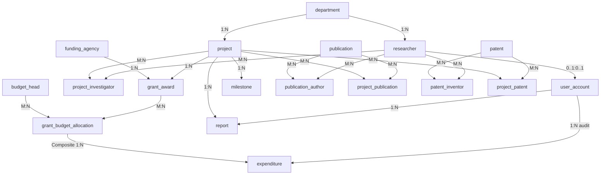

# Relational Schema Specification

This document details the relational translation of the RPGMS conceptual model, specifying all relational signatures, foreign key references, cascading behaviors, and the mapping rules governing transformation from ER to relational algebra.

---

## 1. Relational Signatures

Primary keys are marked with `PK`, foreign keys with `FK → TARGET_TABLE(column)`, and unique candidate keys with `UK`.

1. **`department`** (`dept_id` PK, `dept_code` UK, `dept_name` UK, `building`, `contact_email`, `created_at`)
2. **`researcher`** (`researcher_id` PK, `employee_code` UK, `first_name`, `last_name`, `email` UK, `phone`, `designation`, `dept_id` FK → `department(dept_id)`, `orcid_id` UK, `joined_date`, `is_active`)
3. **`user_account`** (`user_id` PK, `username` UK, `password_hash`, `role`, `researcher_id` FK → `researcher(researcher_id)`, `is_active`, `created_at`)
4. **`funding_agency`** (`agency_id` PK, `agency_name` UK, `agency_type`, `country`, `contact_email`, `website`)
5. **`project`** (`project_id` PK, `project_code` UK, `title`, `abstract`, `dept_id` FK → `department(dept_id)`, `start_date`, `end_date`, `status`, `created_at`)
6. **`project_investigator`** (`project_id` PK/FK → `project(project_id)`, `researcher_id` PK/FK → `researcher(researcher_id)`, `role`, `assigned_date`, `effort_percent`, `pi_flag` UK with `project_id`)
7. **`grant_award`** (`grant_id` PK, `grant_number` UK, `project_id` FK → `project(project_id)`, `agency_id` FK → `funding_agency(agency_id)`, `grant_amount`, `sanction_date`, `grant_start`, `grant_end`, `status`)
8. **`budget_head`** (`head_id` PK, `head_name` UK, `description`)
9. **`grant_budget_allocation`** (`grant_id` PK/FK → `grant_award(grant_id)`, `head_id` PK/FK → `budget_head(head_id)`, `allocated_amount`)
10. **`expenditure`** (`expenditure_id` PK, `grant_id` FK, `head_id` FK → composite FK `(grant_id, head_id)` → `grant_budget_allocation(grant_id, head_id)`, `expense_date`, `amount`, `description`, `voucher_no` UK, `recorded_by` FK → `user_account(user_id)`, `created_at`)
11. **`milestone`** (`milestone_id` PK, `project_id` FK → `project(project_id)`, `title` UK with `project_id`, `description`, `due_date`, `completed_date`, `status`)
12. **`publication`** (`publication_id` PK, `title`, `pub_type`, `venue`, `doi` UK, `issn_isbn`, `pub_date`, `indexing`, `citation_count`)
13. **`publication_author`** (`publication_id` PK/FK → `publication(publication_id)`, `researcher_id` PK/FK → `researcher(researcher_id)`, `author_order` UK with `publication_id`, `is_corresponding`)
14. **`project_publication`** (`project_id` PK/FK → `project(project_id)`, `publication_id` PK/FK → `publication(publication_id)`)
15. **`patent`** (`patent_id` PK, `application_number` UK, `patent_number` UK, `title`, `jurisdiction`, `filing_date`, `grant_date`, `status`)
16. **`patent_inventor`** (`patent_id` PK/FK → `patent(patent_id)`, `researcher_id` PK/FK → `researcher(researcher_id)`)
17. **`project_patent`** (`project_id` PK/FK → `project(project_id)`, `patent_id` PK/FK → `patent(patent_id)`)
18. **`report`** (`report_id` PK, `project_id` FK → `project(project_id)`, `report_type`, `period_start`, `period_end`, `submitted_on`, `submitted_by` FK → `user_account(user_id)`, `summary`, `status`)
19. **`audit_log`** (`log_id` PK, `table_name`, `record_id`, `action`, `old_values`, `new_values`, `changed_at`, `changed_by`)

---

## 2. ER-to-Relational Mapping Rules

The schema was constructed strictly applying formal ER-to-Relational conversion algorithms:

1. **Rule 1 (Strong Entities):**
   - Each regular strong entity in the ER model (`department`, `researcher`, `funding_agency`, `project`, `budget_head`, `publication`, `patent`, `audit_log`) becomes a standalone relation with its primary key chosen from the natural candidate keys or an auto-incrementing integer identifier.

2. **Rule 2 (1:N Binary Relationships):**
   - In 1:N relationships, the primary key of the relation on the `1` side is placed as a foreign key attribute in the relation on the `N` side.
   - *Examples:*
     - `department` (1) to `researcher` (N): `researcher.dept_id` references `department.dept_id`.
     - `department` (1) to `project` (N): `project.dept_id` references `department.dept_id`.
     - `funding_agency` (1) to `grant_award` (N): `grant_award.agency_id` references `funding_agency.agency_id`.
     - `project` (1) to `grant_award` (N): `grant_award.project_id` references `project.project_id`.
     - `project` (1) to `milestone` (N): `milestone.project_id` references `project.project_id`.
     - `project` (1) to `report` (N): `report.project_id` references `project.project_id`.

3. **Rule 3 (M:N Binary Relationships):**
   - Each M:N relationship becomes a new associative (junction) relation.
   - The primary key of the associative relation is the composite combination of the foreign keys referencing the participating relations.
   - Any relationship attributes are assigned to this associative table.
   - *Examples:*
     - `project_investigator`: Junction of `project` and `researcher`. PK: `(project_id, researcher_id)`. Relationship attributes: `role`, `assigned_date`, `effort_percent`.
     - `grant_budget_allocation`: Junction of `grant_award` and `budget_head`. PK: `(grant_id, head_id)`. Relationship attribute: `allocated_amount`.
     - `publication_author`: Junction of `publication` and `researcher`. PK: `(publication_id, researcher_id)`. Relationship attributes: `author_order`, `is_corresponding`.
     - `project_publication`: Pure junction between `project` and `publication`. PK: `(project_id, publication_id)`.
     - `patent_inventor`: Pure junction between `patent` and `researcher`. PK: `(patent_id, researcher_id)`.
     - `project_patent`: Pure junction between `project` and `patent`. PK: `(project_id, patent_id)`.

4. **Rule 4 (1:1 Optional Binary Relationships):**
   - The relationship between `user_account` and `researcher` is 0..1 to 0..1. The foreign key `researcher_id` is placed inside `user_account` with a `UNIQUE` constraint, allowing administrative users without an academic faculty profile while enforcing at most one login account per researcher.

5. **Rule 5 (Relationship-Specific Composite Integrity):**
   - The `expenditure` table represents spending against an allocated budget. Rather than referencing `grant_award(grant_id)` and `budget_head(head_id)` independently, it references the composite primary key of `grant_budget_allocation(grant_id, head_id)`. This structurally prevents recording expenses against budget heads that were never sanctioned for that grant.

---

## 3. Relational Dependency Schema Diagram

---

## 4. Referential Action Matrix

| Foreign Key | Parent Table | Child Table | On Delete | On Update | Rationale |
|---|---|---|---|---|---|
| `fk_res_dept` | `department` | `researcher` | RESTRICT | CASCADE | Academic records cannot orphan faculty members. |
| `fk_user_res` | `researcher` | `user_account` | RESTRICT | CASCADE | Retain login credentials and historical audit identity. |
| `fk_proj_dept` | `department` | `project` | RESTRICT | CASCADE | Departments cannot be dissolved while active projects remain. |
| `fk_pi_proj` | `project` | `project_investigator` | RESTRICT | CASCADE | Project team assignments cannot disappear accidentally. |
| `fk_pi_res` | `researcher` | `project_investigator` | RESTRICT | CASCADE | Faculty with project history must be deactivated, not deleted. |
| `fk_gr_proj` | `project` | `grant_award` | RESTRICT | CASCADE | Financial grants must remain permanently auditable. |
| `fk_gr_agency` | `funding_agency` | `grant_award` | RESTRICT | CASCADE | Funding sources must be preserved for compliance. |
| `fk_alloc_grant` | `grant_award` | `grant_budget_allocation` | RESTRICT | CASCADE | Financial allocations cannot be orphaned. |
| `fk_alloc_head` | `budget_head` | `grant_budget_allocation` | RESTRICT | CASCADE | Expense categories cannot be deleted while assigned. |
| `fk_exp_alloc` | `grant_budget_allocation` | `expenditure` | RESTRICT | CASCADE | Ledger expenses must strictly preserve financial parentage. |
| `fk_exp_user` | `user_account` | `expenditure` | RESTRICT | CASCADE | Maintain user identity of person recording disbursements. |
| `fk_ms_proj` | `project` | `milestone` | RESTRICT | CASCADE | Milestones are historical deliverables of projects. |
| `fk_pa_pub` | `publication` | `publication_author` | CASCADE | CASCADE | Removing a paper removes its author credit rows. |
| `fk_pa_res` | `researcher` | `publication_author` | RESTRICT | CASCADE | Faculty member cannot be deleted if credited on papers. |
| `fk_pp_proj` | `project` | `project_publication` | CASCADE | CASCADE | Junction link disappears if project record is dropped. |
| `fk_pp_pub` | `publication` | `project_publication` | CASCADE | CASCADE | Junction link disappears if publication record is dropped. |
| `fk_pi2_pat` | `patent` | `patent_inventor` | CASCADE | CASCADE | Removing patent removes its inventor link rows. |
| `fk_pi2_res` | `researcher` | `patent_inventor` | RESTRICT | CASCADE | Inventors cannot be deleted if holding patents. |
| `fk_ppt_proj` | `project` | `project_patent` | CASCADE | CASCADE | Junction link disappears if project record is dropped. |
| `fk_ppt_pat` | `patent` | `project_patent` | CASCADE | CASCADE | Junction link disappears if patent record is dropped. |
| `fk_rep_proj` | `project` | `report` | RESTRICT | CASCADE | Project reports are formal legal submissions. |
| `fk_rep_user` | `user_account` | `report` | RESTRICT | CASCADE | Preserves identity of submitting officer. |
