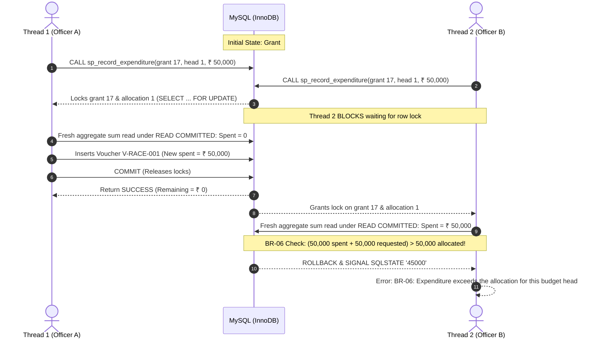

# Transaction Management, ACID Guarantees & Concurrency Control

## 1. Plain-Language Explanation of ACID Properties

Transactions ensure that multi-step database interactions behave predictably, even in the event of hardware crashes, network disconnects, or simultaneous multi-user interactions.

> **Real-World Analogy: An ATM Cash Withdrawal**
> Suppose you withdraw ₹ 10,000 from an ATM:
> 1. The bank debits ₹ 10,000 from your account ledger.
> 2. The physical ATM dispenser counts and delivers the paper currency.
>
> If the machine jams or loses power after step 1 but before step 2, you must NOT lose your money. The debit must be reversed automatically. Either both steps succeed completely, or neither does.

| ACID Principle | Meaning | Real-World RPGMS Analogy |
|---|---|---|
| **Atomicity** ("All or Nothing") | A transaction's modifications are either all applied or completely rolled back. | When registering a project via `sp_register_project`, if the project row inserts but the PI assignment fails, the project is rolled back completely. |
| **Consistency** ("Rules are Preserved") | The database moves from one valid state to another valid state, violating zero constraints or triggers. | Spent money plus remaining balance strictly equals the sanctioned grant amount. Workload never exceeds 100%. |
| **Isolation** ("No Interrupted Peeking") | Concurrent transactions execute without seeing each other's intermediate uncommitted states. | Two research officers spending against the same ₹ 50,000 budget head simultaneously cannot both succeed. |
| **Durability** ("Survives Crashes") | Once committed, changes are permanently written to InnoDB redo logs and cannot be lost. | A recorded expenditure voucher remains safe even if the server reboots immediately afterward. |

---

## 2. Empirical Demonstrations & Executed Output

The following demonstrations were executed directly against `rpgms_test` using `db/09_transaction_demo.sql` and automated concurrency harnesses.

### 2.1 Atomicity: Automatic Rollback on Procedure Failure
Calling `sp_register_project` with an invalid/non-existent researcher ID (`9999`):
```sql
CALL sp_register_project(
  'RP-2026-999', 'Disposable Atomic Test', 'Abstract',
  1, '2026-01-01', '2028-12-31', 9999, 20.00, @new_id
);
```

- **Output:**
```text
ERROR 1644 (45000): Researcher does not exist
```

- **Verification:**
```sql
SELECT COUNT(*) FROM project WHERE project_code = 'RP-2026-999';
-- Result: 0 (No orphan project was left in the table!)
```

---

### 2.2 Explicit COMMIT vs. ROLLBACK
```sql
START TRANSACTION;
INSERT INTO funding_agency (agency_name, agency_type, country)
VALUES ('Disposable Test Agency', 'Private', 'India');

-- Inside transaction: row is visible (Count = 1)
ROLLBACK;

-- After rollback:
SELECT COUNT(*) FROM funding_agency WHERE agency_name = 'Disposable Test Agency';
-- Result: 0 (Row vanished completely)
```

---

### 2.3 SAVEPOINT & Partial Rollback
```sql
START TRANSACTION;
INSERT INTO department (dept_code, dept_name, building)
VALUES ('TESTD', 'Disposable Testing Department', 'Test Lab');
SAVEPOINT sp_after_dept;

INSERT INTO department (dept_code, dept_name, building)
VALUES ('TEMP2', 'Second Disposable Department', 'Temp Lab');

ROLLBACK TO SAVEPOINT sp_after_dept;
COMMIT;

SELECT dept_code FROM department WHERE dept_code IN ('TESTD', 'TEMP2');
-- Result: 'TESTD' was preserved and committed; 'TEMP2' was successfully undone.
```

---

### 2.4 Concurrency Isolation: The Double-Spend Race Test

When two research officers attempt to disburse the final remaining ₹ 50,000 from an equipment head at the exact same millisecond:



- **Actual Test Harness Output (`tests/test_transactions.py`):**
```text
Created test grant 17 with ₹ 50,000 allocation.
Session 2 -> SUCCESS
Session 1 -> BLOCKED: 1644 (45000): BR-06: Expenditure exceeds the allocation for this budget head
```
*Conclusion:* Under `READ COMMITTED` isolation with `SELECT ... FOR UPDATE` row locks, concurrent race conditions are eliminated, guaranteeing 100% budget integrity.
